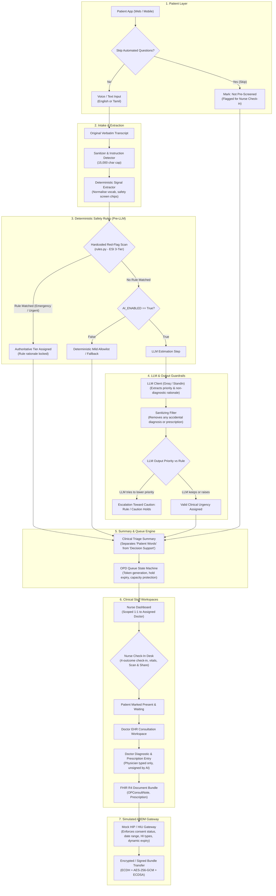

# LifeLine System Architecture & Data Flow

This document details the architectural flow, component boundaries, and security barriers of LifeLine.

---

## 1. End-to-End Pipeline Data Flow

The diagram below illustrates the exact path of clinical data from initial patient input through safety guardrails, decision support, queue management, and clinician workflows.

---

## 2. Where Rules End and the LLM Begins

A strict architectural invariant in LifeLine is the absolute separation between deterministic safety logic and probabilistic machine learning:

1. **Pre-LLM Guardrail Boundary:**
   - The original raw transcript is immediately evaluated by deterministic substring pattern matching (`app/triage/rules.py` and `app/intake/redflag_scan.py`).
   - If an **Emergency** rule matches (e.g. chest pain with breathlessness, stroke signs, severe hemorrhage, pediatric seizure), **the LLM is never invoked**. The emergency outcome is sealed deterministically.
   - If the text contains instruction-like phrases (prompt injection attempt) or exceeds length thresholds, the pipeline flags `injection_suspected` and forces the priority to at least **Same-Day (Urgent)**, refusing to allow any prompt text to alter rules.

2. **The LLM Domain:**
   - The LLM is invoked **only** for cases where no emergency red-flag rule fired and `AI_ENABLED=True`.
   - The LLM receives structured clinical context (symptoms, duration, age, chronic conditions, and verbatim transcript marked strictly as untrusted user data).
   - The prompt instructs the LLM to categorize urgency (`routine` or `same-day`) and provide a brief observational rationale. The LLM is explicitly forbidden from suggesting diagnoses or pharmaceutical treatments.

3. **Post-LLM Safety Filter:**
   - All text returned by the LLM is passed through a clinical keyword filter (`app/triage/service.py`) that scrubs diagnostic statements (e.g. "migraine", "dengue", "viral infection") and drug names/dosages (e.g. "paracetamol", "ibuprofen", "500 mg").
   - If the LLM claims low confidence, returns invalid JSON, times out, or suggests lowering a rule-based priority, the pipeline overrides the LLM and escalates toward caution.

---

## 3. Server-Side Scoping and Privacy Invariants

- **1:1 Nurse-to-Doctor Scoping:** Every nurse is associated with exactly one physician in `NurseAssignment`. The queue endpoints (`/queue`, `/queue/entry/{id}`, `/queue/action`) enforce this scoping server-side. Unassigned nurses receive a descriptive empty state and zero patient data.
- **Role-Based Record Isolation:**
  - **Nurses** can view triage summaries, chief complaints, and vitals. Nurses **never** receive diagnosis history or prescriptions.
  - **Treating Doctors** have direct access to their own past encounters with their active patients.
  - **External Doctors** cannot see outside encounter history without an active, approved, unexpired, and unrevoked ABDM consent request matching the date range and record type.
- **Auditability:** Every flag change, queue reorder, priority alteration, emergency transfer, and record access is persisted in append-only tables (`AuditLog`, `NurseActionLog`, `ConsentStatusHistory`).
